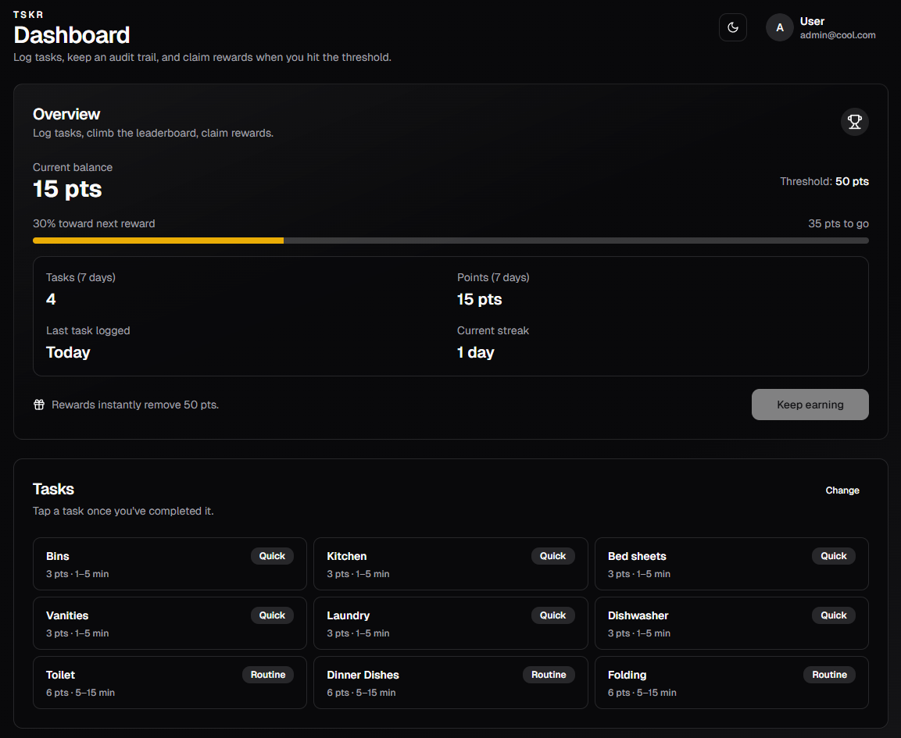

# tskr

tskr makes household tasks fair and visible by assigning chores, logging completions, and turning points into rewards. Recognize hard work with perks like pocket money, reduced rent, or a shared flatmate pool.

Built for families, roommates, and shared houses that want a simple points-based chore loop.



More screenshots: [Assignments](screenshots/assignments.png), [Household](screenshots/household.png)

## Features

- Assign tasks and log completions with an approval flow.
- Track points, streaks, and reward progress on a shared dashboard.
- Combine household and member reward caps across calendar or rolling periods.
- Keep an audit trail and leaderboard to stay aligned.
- Organize by household with role-based access.

## Assignment cycles

Recurring assignments use the household's calendar: daily tasks reset at local
midnight, weekly on Monday, fortnightly on alternating Mondays, monthly on the
first, quarterly at the start of each quarter, and yearly on January 1. Completing
a task just before a boundary counts toward the cycle that is ending. The next
cycle starts fresh, while the completion stays in History. The assignment queue
shows "Completed last cycle" when the preceding cycle's target was met, plus the
last completion and next reset dates.

Pending submissions count toward assignment progress while awaiting approval;
points are added after approval. Rejected or reverted submissions do not count.
Use the assignment's Complete action to record its progress: logging the same
preset separately does not complete the assignment. Changing recurrence preserves
existing completion history.

## Reward claim limits

Household managers can add limits under household settings. Each rule sets a maximum
number of rewards, a period, and a target: the shared household allowance, each member
separately, or one named member. All applicable rules must allow a claim; member rules
add restrictions rather than overriding other limits. For example, combine 10 rewards
per calendar month across the household with 2 rewards in any 48 hours per member.

Calendar days, Monday-start weeks, and months follow the household time zone. Rolling
windows measure elapsed time, configurable in minutes, hours, days, or weeks up to
365 days. Approved, non-reverted claims consume allowance. Points continue to
accumulate, and every claim still costs points. With no rules, claims remain unlimited.
Up to 20 rules can be combined; the dashboard identifies blocking rules and shows the
next allowance date.

Monthly rules offer **Carry over unused claims**, off by default. When enabled, unused
claims can accumulate up to one additional month's base allowance, on top of the new
month's allowance. This is a quantity cap, not an age limit: saved claims do not expire.
The dashboard separates this month's allowance from carried claims. Shared rules keep
one shared balance; each-member and named-member rules keep individual balances. All
other rules still apply, including day, week and rolling caps.

Monthly allowance and carryover edits normally take effect next month. Initial
carryover enablement starts in the current month, counts existing claims (including
over-limit usage), and never credits earlier months. Lowering the monthly allowance
also lowers the carry cap, but preserves claims already saved above that cap and stops
further accumulation until there is room. Disabling carryover stops new saving from
its effective month, preserving the existing bank. Reenabling applies next month.
New rules take effect immediately and count existing current-period claims. Other
periods keep their immediate limit-edit behavior.

Saved claims are spent oldest first. Reverting a reward refunds its points and returns
the claim to its original still-valid grant; expired or forfeited units are not revived.
Returning a spent saved claim can take a preserved balance above the current carry cap.
Rules retain their identities across saves. Removing a rule, or changing its target or
period, retires that allowance; a replacement starts separately and receives no saved
balance from it. Rejoining a household starts a new individual allowance, without
accrual through a membership gap.

The upgrade preserves existing rule IDs, settings, logs, points and current available
claims, with carryover disabled. Monthly accounting begins at initialization; it does
not reconstruct unknown earlier policies or grant saved claims for previous months.
Grants and policy history are stored durably and months advance lazily, without a
scheduled job. Timezone edits leave an existing month's boundary intact and apply the
new timezone to following monthly grants. Settings saves include only edited fields;
concurrent rule edits require reloading settings. Older clients can echo unchanged
rules without IDs or carryover fields, preserving stored values, but must reload using
a current client to replace or remove existing rules safely.

Before upgrading, stop the app and back up its SQLite database. Run only the upgraded
backend against the migrated database: an older backend's settings writer can delete
monthly allowance history. To roll back, stop the upgraded app and restore the matching
pre-upgrade database backup before starting the older image. Restoring that backup
also discards changes made since the backup; changing only the image is not a safe rollback.

## Tech stack

- Next.js 16 + React 19
- NextAuth (credentials + Google OAuth)
- Prisma + SQLite (default)
- Tailwind CSS + Radix UI

## Internationalization

Translations live in `src/locales/<lang>/translation.json`. Locale folders must be lowercase (e.g., `en`, `pt-br`).

Add a new language:
1. Create `src/locales/<lang>/translation.json`.
2. Run `pnpm i18n:sync` to regenerate `src/locales/supported.json`, enforce static translation keys, and update locale keys from the codebase.

`i18next-scanner` is configured to prune unused keys (`removeUnusedKeys: true`).
CI runs `pnpm i18n:check` to ensure locale files are up to date and dynamic translation keys are not used.

Translation workflow:
- Run `pnpm prep` before opening a PR. This is the primary local quality gate.
- `prep` includes i18n sync, lint fixes, TypeScript compile, a production build, and tests.
- `check` includes i18n sync, lint, TypeScript compile, a production build, and tests.
- Run `pnpm i18n:sync` when you only want to refresh locale files while working.
- CI runs `pnpm i18n:check`, which fails if locale files would change.

## Auth options

- Email + password credentials.
- Optional Google OAuth via `GOOGLE_CLIENT_ID` and `GOOGLE_CLIENT_SECRET`.

## Getting Started

Prereqs:
- Node 24 (matches `flake.nix`) or use the Nix dev shell
- pnpm 10 (via `corepack enable`)

If you have Nix + direnv installed, entering the repo will automatically load the dev shell:

```bash
direnv allow
```

1) Copy the example env file:

```bash
cp .env.example .env
```

2) Update `.env` as needed. At minimum set `NEXTAUTH_SECRET` and `NEXTAUTH_URL`.
   `DATABASE_URL` defaults to `file:./prisma/dev.db`. Google OAuth reads from
   `process.env.GOOGLE_CLIENT_ID` and `process.env.GOOGLE_CLIENT_SECRET` (leave blank
   to disable the Google button). Set `SUPER_ADMIN_EMAIL` to bootstrap the first
   super admin account if none exists; a temporary password is generated and
   logged on first bootstrap (password reset required on first login). Set
   `SUPER_ADMIN_FORCE_PASSWORD=1` to rotate the password on the next bootstrap.
   Push notifications need the VAPID variables.

3) Install dependencies and prepare Prisma:

```bash
pnpm install
pnpm db:generate
pnpm db:setup
```

4) Start the dev server:

```bash
pnpm dev
```

Open [http://localhost:3000](http://localhost:3000) with your browser to see the result.

## Releases

Releases use [Release Please](https://github.com/googleapis/release-please-action).
After a push to `main` passes i18n, lint, TypeScript compilation, tests, the
production build, and a container startup check, the workflow creates or updates a release PR with the version
bump and changelog. Merge that PR when the changes are ready to ship. The merged
commit must pass the same checks before the workflow creates the `x.y.z` tag and
GitHub Release, then publishes the release image to GHCR for amd64 and arm64.
`latest` advances after the image is published. The release notes include the
immutable image digest for deployments.

Use Conventional Commit titles for squash merges:

| Prefix | Version effect |
| --- | --- |
| `fix:` or `perf:` | Patch |
| `feat:` | Minor |
| `!` or a `BREAKING CHANGE:` footer | Major |
| `docs:`, `test:`, `ci:`, `build:`, `style:`, `refactor:`, `deps:`, ordinary `chore:` | No release by themselves |

User-visible dependency or container fixes should use `fix(deps):` or
`fix(container):` so they ship. Tags keep the existing format without a `v`
prefix. Release Please now manages `package.json` and
`.release-please-manifest.json` together, starting from the existing `1.2.0` tag.
Do not manually bump versions, cut tags, or publish images.

Repository setup:

1. Install the release bot GitHub App on this repository with **Contents**,
   **Issues**, and **Pull requests** read/write permissions. Add repository
   Actions environment secrets `RELEASE_BOT_APP_ID` and `RELEASE_BOT_PRIVATE_KEY`
   in the `release` environment, as in
   `obsidian-sync-mcp`. The App token lets the release PR trigger CI automatically.
2. Restrict the `release` environment's deployment branches to `main`.
3. Require the `build-and-lint` CI job in branch protection for `main`.

If publication fails after the GitHub Release is created, rerun the failed CI
workflow for that merged release commit. It verifies the tag points to the exact
tested commit, reuses an existing multi-architecture image if one was already
published, and repairs the release notes. Retrying an older release does not
move `latest` back. Publishing is part of the same workflow, so tags created
with `GITHUB_TOKEN` do not need to trigger another workflow.

## Security checks

CI reports `pnpm audit` findings without blocking PRs on dependency advisories.
Routine PR builds reuse the Docker cache and run the startup smoke check.
Release builds refresh OS packages and report vulnerabilities in the exact
published digest for both amd64 and arm64, including on retries. Image scans
and report uploads are informational too: findings or scanner failures do not
block releases. Use the full reports to assess actual exposure and prioritize
updates, rather than treating package presence as proof of an exploitable issue.

Optional local checks (image checks need Docker and Trivy):

```bash
pnpm audit
docker buildx build --load --no-cache-filter base -t tskr-security:local .
bash scripts/ci/docker-smoke.sh tskr-security:local
trivy image --scanners vuln tskr-security:local
```

## Docker

Pull the image:

```bash
docker pull ghcr.io/jonocairns/tskr:latest
```

Run the container (persists the SQLite db and generated secrets under `/data`):

```bash
docker run --rm \
  -p 3000:3000 \
  -v tskr-data:/data \
  -e NEXTAUTH_URL="http://localhost:3000" \
  ghcr.io/jonocairns/tskr:latest
```

For a repeatable deployment, use the `ghcr.io/jonocairns/tskr:x.y.z@sha256:…`
reference from the GitHub Release notes. Publishing an image does not restart
an existing container; pull the chosen release and recreate your container with
the same `/data` volume.

Build and run locally instead:

```bash
docker build -t tskr .

docker run --rm -p 3000:3000 -v tskr-data:/data --env-file .env tskr
```

Notes:
- The image binds to `0.0.0.0` and checks `/api/health` on loopback. This public
  liveness route returns `200` with `{"status":"ok"}` without auth or database access.
  Leave `HOSTNAME` unset in the deployment so the image's bind address is used.
- `DATABASE_URL` is optional; the entrypoint defaults to `file:/data/dev.db`.
- Migrations run on container start when Prisma migrations are present.
- Set `NEXTAUTH_SECRET` for stable sessions. If unset, the entrypoint generates one and
  stores it in `/data/tskr-secrets.env`.
- Google OAuth reads `GOOGLE_CLIENT_ID` and
  `GOOGLE_CLIENT_SECRET` (leave them blank to disable the Google button).
- Set `VAPID_PUBLIC_KEY`, `VAPID_PRIVATE_KEY`, and `VAPID_SUBJECT` to enable push
  notifications; otherwise the entrypoint will generate keys on first run.
